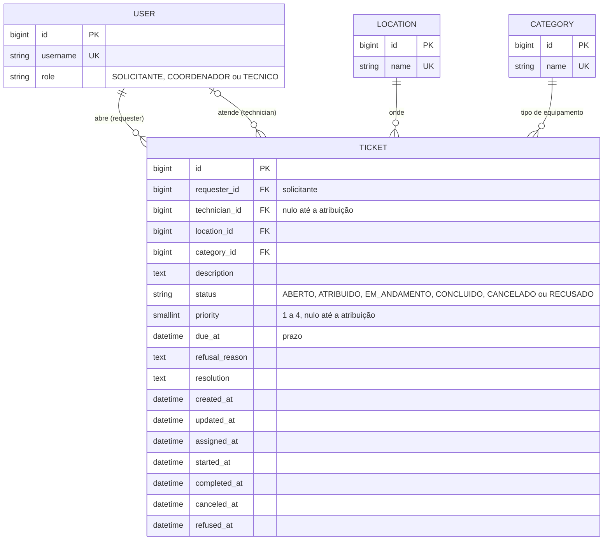

# Modelagem do banco — SU01

> Gerado com apoio de IA (Claude Code) em 24/11/2026 para o card SU01 do Trello. Revisado por Suetone antes da implementação.
> Front-end decidido pelo grupo: **templates Django** (sem SPA, sem CORS; DRF opcional).

## Decisões

| Decisão | Motivo |
| --- | --- |
| Usuário customizado (`accounts.User`, herda `AbstractUser`) com campo `role` | O `AUTH_USER_MODEL` precisa existir antes da primeira migration. Um campo com três valores é mais simples de explicar e de filtrar do que grupos/permissões do Django para três papéis fixos. |
| Ordem de serviço **dentro do próprio chamado** (sem model `ServiceOrder`) | A proposta trata chamado e ordem como o mesmo objeto em fases diferentes (aberto → atribuído → em andamento → concluído). Dois models obrigariam a sincronizar status entre eles. |
| `Location` e `Category` como tabelas | A fila do coordenador (US4) filtra por local e por tipo; tabelas evitam variações de digitação ("Lab 1" vs "lab1") e alimentam os `<select>` e o seed. |
| Prioridade como `IntegerChoices` (1 = baixa … 4 = urgente) | A US8 ordena por prioridade; inteiro ordena direto no banco (`order_by("-priority")`). |
| Prazo (`due_at`) calculado a partir da prioridade na atribuição | A US4 pede "responsável e prazo"; o coordenador escolhe a prioridade e o prazo sai da tabela de SLA (`Ticket.deadline_for`). |
| Um carimbo de tempo por transição | A US7 (tempo médio, % no prazo) e a US6 (atrasados) saem direto desses campos, sem tabela de histórico. |
| Identificadores em inglês, rótulos em português | Os cards SU01/PL11 usam `Ticket`/`Category`; o usuário vê apenas `verbose_name` e mensagens em português. |

## Diagrama

## Status e conjuntos usados pelas regras

| Conjunto | Status | Usado em |
| --- | --- | --- |
| `ACTIVE_STATUSES` | aberto, atribuído, em andamento | US1 — máx. 3 por solicitante |
| `TECHNICIAN_LOAD_STATUSES` | atribuído, em andamento | US4 — **Recusa 1**, máx. 5 por técnico; US6 atrasados; US8 pendentes |
| `CANCELLABLE_STATUSES` | aberto, atribuído | US3 cancelar, US5 recusar |

## Integridade no banco

- `CheckConstraint`: em `ATRIBUIDO`, `EM_ANDAMENTO` e `CONCLUIDO` o chamado **precisa** ter técnico e prioridade.
- `on_delete=PROTECT` em todas as FKs: apagar usuário, local ou tipo com chamados vinculados é recusado (preserva o histórico da US7).
- Índices em `status`, `(technician, status)` e `(requester, status)` — as contagens das recusas e as filas por papel filtram exatamente por esses pares.

## O que fica para os próximos cards

As transições (abrir, atribuir, iniciar, concluir, cancelar, recusar) e as três recusas oficiais **não** entram no SU01: ficam numa camada de serviço (`tickets/services.py`) nos cards SU04–SU13, para que tela e eventual API usem a mesma regra.

| SLA por prioridade | Prazo a partir da atribuição |
| --- | --- |
| Urgente | 4 h |
| Alta | 24 h |
| Média | 72 h |
| Baixa | 120 h |
